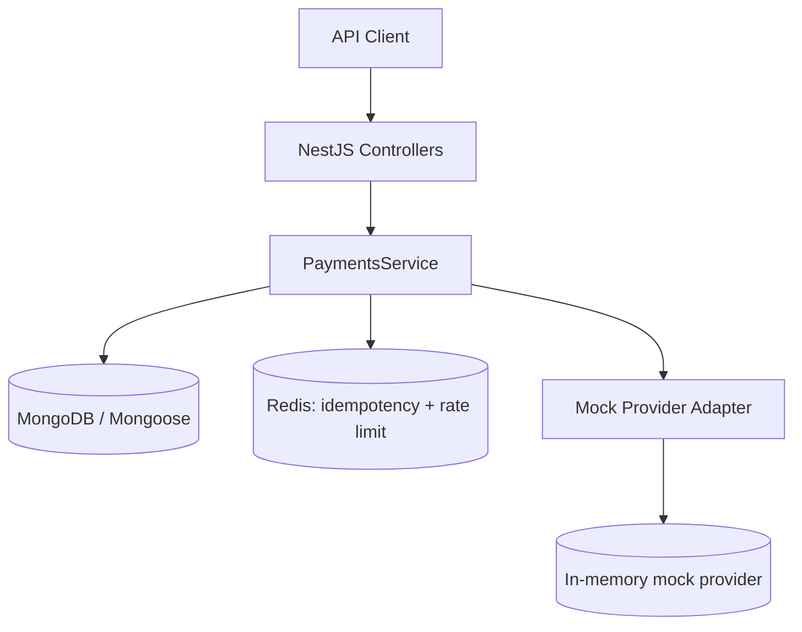

# Paymore Payment Simulator

A learning/demo REST API for a payment workflow. It models companies, terminals and payments, and simulates an external payment provider. It is **not production payment software** and does not process real cards or money.

## Stack
- Node.js + TypeScript (`strictNullChecks`, `noImplicitAny`)
- NestJS modular architecture; Express is the underlying HTTP platform
- MongoDB + Mongoose
- Redis via ioredis (idempotency, rate limiting; Redis outage behavior documented in code)
- Jest + Supertest; Swagger/OpenAPI
- Docker Compose for local MongoDB and Redis

## Express vs NestJS
Express is a lightweight HTTP framework with minimal built-in structure; teams choose routing, validation, dependency management and conventions. NestJS builds on Express by default and provides modules, dependency injection, guards, pipes, controllers and testing conventions. This project uses NestJS to demonstrate a maintainable modular structure while still running on the Express adapter.

## Architecture


## Data model
- `companies`: `name`, unique `code`, `isActive`.
- `terminals`: `companyId`, unique `terminalCode`, `isActive`.
- `payments`: company/terminal refs, Unique compound index on payments.companyId + merchantReference:
each company can use a merchant reference only once `merchantReference`, integer minor-unit `amount`, currency, status, provider reference, cumulative refunded amount and inquiry metadata.

### Index rationale
- Unique `companies.code`: prevent duplicate company codes.
- Unique `terminals.terminalCode`: prevent terminal code duplication; compound `{companyId, terminalCode}` supports tenant-scoped lookup.
- Unique compound index on payments.companyId + merchantReference:
each company can use a merchant reference only once.
- `{companyId, createdAt}`: recent company transaction listing.
- `{terminalId, status, createdAt}`: terminal/status operational filtering.

Amounts are integer minor units (e.g. `12500` = `125.00 TRY`) to avoid floating-point money calculations.

## Run locally
Requirements: Node.js 20+, npm, Docker Desktop.

```bash
cp .env.example .env
docker compose up -d
npm install
npm run start:dev
```

- API: `http://localhost:3000/api`
- Swagger: `http://localhost:3000/docs`
- Health: `GET http://localhost:3000/api/health`

## Example flow
1. Create company: `POST /api/companies` body `{"name":"Demo Merchant","code":"DEMO"}`.
2. Create terminal: `POST /api/terminals` body `{"companyId":"<company ObjectId>","terminalCode":"TERM-01"}`.
3. Create payment: `POST /api/payments` with header `Idempotency-Key: order-1001` and body:

```json
{"companyId":"<company ObjectId>","terminalId":"<terminal ObjectId>","merchantReference":"ORDER-1001","amount":12500,"currency":"TRY","scenario":"SUCCESS"}
```

Supported mock scenarios: `SUCCESS`, `DECLINED`, `PENDING`, `TIMEOUT`. `TIMEOUT` stores a successful provider-side outcome but returns `UNKNOWN`, allowing `POST /api/payments/:id/inquiry` to recover the outcome.

Other endpoints:
- `GET /api/payments/:id`
- `GET /api/payments?companyId=<id>`
- `POST /api/payments/:id/inquiry`
- `POST /api/payments/:id/void`
- `POST /api/payments/:id/refund` body `{"amount":2500}`

## Payment lifecycle / decision table
| Current status | Operation | Result / rule |
|---|---|---|
| PENDING (simulator authorization stage) | Void | VOIDED |
| SUCCESS | Partial refund | PARTIALLY_REFUNDED |
| SUCCESS / PARTIALLY_REFUNDED | Remaining refund | REFUNDED when cumulative amount equals captured amount |
| UNKNOWN / PENDING | Inquiry | Update only when provider returns a definitive result |
| FAILED / VOIDED | Refund | Rejected |

Provider semantics differ. In a real integration, distinguish authorization from capture explicitly; this demo treats PENDING as the voidable stage and SUCCESS as captured.

## Redis behavior
- Idempotency key stores a request fingerprint with 24-hour TTL. Same key + same payload returns existing result; same key + different payload returns 409.
- Rate limit uses an incrementing key with a configured expiry.
- If Redis is unavailable, rate limiting fails open. Payment creation fails closed when idempotency cannot be safely reserved. Production policy must be explicitly reviewed.
- A robust production implementation should atomically reserve and store the final response, handle in-progress requests, and recover abandoned reservations.

## Concurrency and consistency notes
- Refund amount is checked against the remaining refundable amount.
- A conditional MongoDB update protects the cumulative refunded amount against concurrent local updates.
- There is an unavoidable distributed-systems gap between calling a provider and committing MongoDB. If the provider succeeds but the database update fails, reconcile/inquire with the provider before retrying. Production design should use a durable operation record/outbox and provider idempotency.
- This simulator's provider keeps outcomes in memory; restarting the app clears provider history. It is for demonstration only.

## Tests
```bash
npm test
npm run test:e2e
```
The unit tests cover refund validation. The E2E smoke test covers the health endpoint. Extend with database-backed payment lifecycle tests before treating this as a complete production test suite.

## Day-by-day deliverables mapping
| Day | Deliverable in this repository |
|---|---|
| 1 | Strict TypeScript, NestJS modules, REST controllers/services, async provider calls |
| 2 | DTO validation, global validation pipe, HTTP exceptions, Swagger, Express/NestJS comparison |
| 3 | Company/terminal/payment schemas, indexes, company transaction query; MongoDB atomic conditional refund update |
| 4 | Redis TTL idempotency, rate limit, cache primitives and outage notes |
| 5 | Payment statuses, inquiry, void/refund lifecycle and decision table |
| 6 | Mock provider success/decline/pending/timeout, API endpoints and tests |
| 7 | README, architecture diagram, API docs, tests and demo instructions |

## Known limitations / next improvements
- Add authentication and authorization; current demo endpoints are intentionally unauthenticated.
- Validate that a terminal belongs to the supplied company before creating a payment.
- Persist mock provider outcomes in a separate collection instead of process memory.
- Add database-backed E2E tests for company → terminal → payment → inquiry/refund flows.
- Implement atomic idempotency reservation + response persistence and a recovery job for stuck operations.
- Add structured logging, metrics, audit trail, pagination and reconciliation reports.
- Use a provider sandbox and security review before any real payment integration.

## Security note
Never store PAN/CVV or secrets in this project. Use environment variables for credentials and redact sensitive data from logs. This repository is an educational simulator, not a certified payment gateway.
